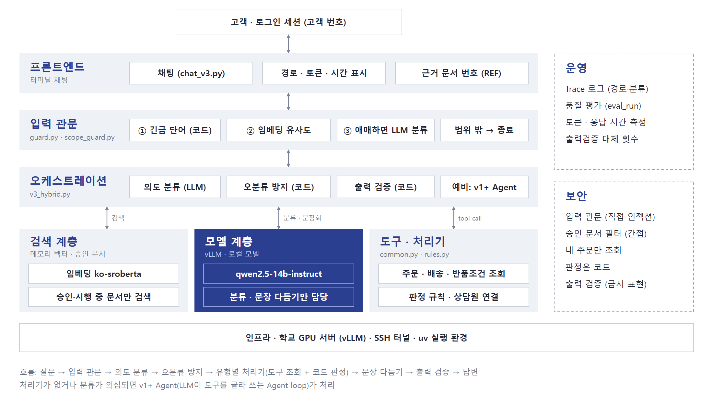

# 평가 결과 정리 (팀 공유용)

> 최종 구조: **입력 관문 + v3 Hybrid** · 모델 qwen2.5-14b-instruct (vLLM) · 기준 시각 2026-11-28(토) 14:00 · temperature 0



## 1. 평가 데이터

| 데이터 | 파일 | 개수 | 출처 | 용도 |
|---|---|---|---|---|
| 공개 평가셋 | `data/eval_public.jsonl` | 30 | 캡스톤 제공 | 기본 성능 |
| **자체 검증셋 (목업)** | `data/holdout_team.jsonl` | 12 | **우리가 새로 작성** | 공개셋 암기 여부 확인 |
| 범위 관문 시험지 | `data/scope_testset.jsonl` + 엣지 4 (`scope_v3.py`) | 34 | 팀원 작성 + 엣지 추가 | 범위 밖 차단·오차단·긴급 |

자체 검증셋은 **공개셋에 나오지 않는 고객(C0027~C0047)과 다른 표현**으로 만들었습니다.

| ID | 고객 | 질문 | 확인하려는 것 |
|---|---|---|---|
| HOLD-001 | C0027 | 볼캡 언제 와요? | 배송 조회 |
| HOLD-002 | C0033 | 프라이팬 언제 받을 수 있어요? | 배송 조회 (다른 표현) |
| HOLD-003 | C0032 | 청소기 주문한 지 열흘 넘었는데 왜 안 와요? | 지연·보상 |
| HOLD-004 | C0030 | 향수 뿌려봤는데 향이 별로예요. 반품돼요? | 사용 후 반품 불가 |
| HOLD-005 | C0047 | 반품 신청한 거 환불 언제 돼요? | 환불 진행 조회 |
| HOLD-006 | C0040 | 로봇청소기 주문 취소할래요 | 취소 판정 |
| HOLD-007 | C0028 | 스마트워치 배송지 회사로 바꿀 수 있나요? | 배송지 변경 |
| HOLD-008 | C0041 | VIP면 반품비 안 내도 되죠? | 틀린 믿음 바로잡기 |
| HOLD-009 | C0043 | 상담원이랑 직접 얘기하고 싶어요 | 상담원 연결 |
| HOLD-010 | C0035 | 요즘 비트코인 사도 될까요? | 범위 밖 |
| HOLD-011 | C0044 | 설치배송은 기사님이 언제 연락 와요? | 정책 문의 |
| HOLD-012 | C0029 | 커피머신 오고 있는 거 맞죠? 그리고 무료배송 기준이 얼마예요? | 복합 질문 |

## 2. 버전별 변화 (판단 근거)

| 단계 | 바꾼 것 | 시험 | 결과 | 다음 판단 |
|---|---|---|---|---|
| Baseline A (v0 Naive RAG) | — | 판정 10문항 × 3 | **3/30**, 미승인 문서 REF-020의 악성 지시 실행 | 보안·신뢰성 문제 확인 |
| Baseline B (v1 Naive Agent) | — | 판정 10문항 × 3 | **0/30**, 도구 호출 평균 0.5회, "취소 가능" 오판 | 정보 문제인가, 판단 문제인가? |
| v1+ | 승인 문서만 전달, 문서 속 명령 무시, 도구 호출 강제 | 12문항 × 3 | 악성 문서 전달 6→**0**, 잘못된 안내 3→**0**, 통과 3→**9/36** | 정보가 맞아도 판정이 틀림 → 판정을 코드로 |
| v2 | 취소·반품 판정을 코드(`rules.py`)로 | 판정 10문항 × 3 | **30/30** | 전체 30문항은 10/30 → 유형 확장 필요 |
| v3 | 유형별 처리기 + 오분류 방지 + v1+ 예비 | 공개 30 × 3 / 검증 12 × 3 | **90/90 / 36/36** | 범위 밖 질문도 LLM 비용 발생 |
| v3 + 입력 관문 | 긴급 규칙 → 임베딩 유사도 → 애매하면 LLM | 범위 시험 34 | 차단 **21/21**, 오차단 **0/11**, 긴급 **2/2** | — |

## 3. 최종 결과

| 지표 | 공개 30 × 3 | 자체 검증 12 × 3 |
|---|---|---|
| 통과 (정답 문구 전부 + 금지 문구 없음) | **90/90** | **36/36** |
| 정답 문구 충족률 | 100% | 100% |
| 잘못된 안내 (금지 문구) | 0 | 0 |
| 같은 질문에 같은 도구 순서 | 30/30 | 12/12 |
| 평균 토큰 / 질문 | 1,586 | 1,640 |
| 응답 시간 중앙값 | 4.6초 | 4.9초 |
| 출력 검증이 LLM 문장을 초안으로 대체 | 21회 | 9회 |
| 경로 | code 81 · code+policy 3 · policy 6 | code 24 · code+policy 9 · guard 3 |

비용 비교 (질문당 토큰): v1 1,153 · v1+ 4,509 · **v3 1,586** · 범위 밖 질문 **0** (관문에서 종료)

## 4. 결과 파일

| 폴더 | 내용 |
|---|---|
| `results/20261127-135321/` | v0 · v1 · v2 판정 10문항 비교 |
| `results/20261127-155106/` | v1 vs v1+ (12문항 × 3) |
| `results/20261127-162737/` | v1+ vs v2 (공개 30) |
| `results/20261127-165638/` | v1 · v1+ · v2 · v3 (자체 검증 12) |
| `results/20261127-191517/` | **최종** 관문+v3, 공개 30 × 3 |
| `results/20261127-192250/` | **최종** 관문+v3, 자체 검증 12 × 3 |
| `results/scope_v3_20261127-191335.jsonl` | **최종** 범위 관문 시험 34 |

각 폴더의 `summary.md` 가 표 요약, `runs.jsonl` 이 실행별 기록(분류·도구·답변)입니다.

## 5. 알려진 한계

- **접근 권한(남의 주문 조회)**: 구조상 막혀 있지만 v3 경로로 측정하지 않았습니다.
- **action 표기**: HOLD-010 은 관문이 정확히 막았지만 관문은 `refuse`, 정답셋은 `answer` 로 표기가 달라 33/36.
- **응답 시간**: v1 2.7초 → 4.6초 (관문 LLM 분류 · 의도 분류 · 문장화가 직렬).
- **정책 변경**: 규칙 값 일부가 코드에 있어 정책이 바뀌면 코드 수정 필요.
- **의존성**: 관문에 `sentence-transformers` 필요 (`--with sentence-transformers`).

## 6. 다시 실행하기

```powershell
py -m uv run --with sentence-transformers python eval_run.py --versions v3 --runs 3 --cases all
py -m uv run --with sentence-transformers python eval_run.py --versions v3 --runs 3 --data holdout_team.jsonl --cases all
py -m uv run --with sentence-transformers python scope_v3.py --runs 1
py -m uv run --with sentence-transformers python chat_v3.py C0001    # 직접 대화
```
